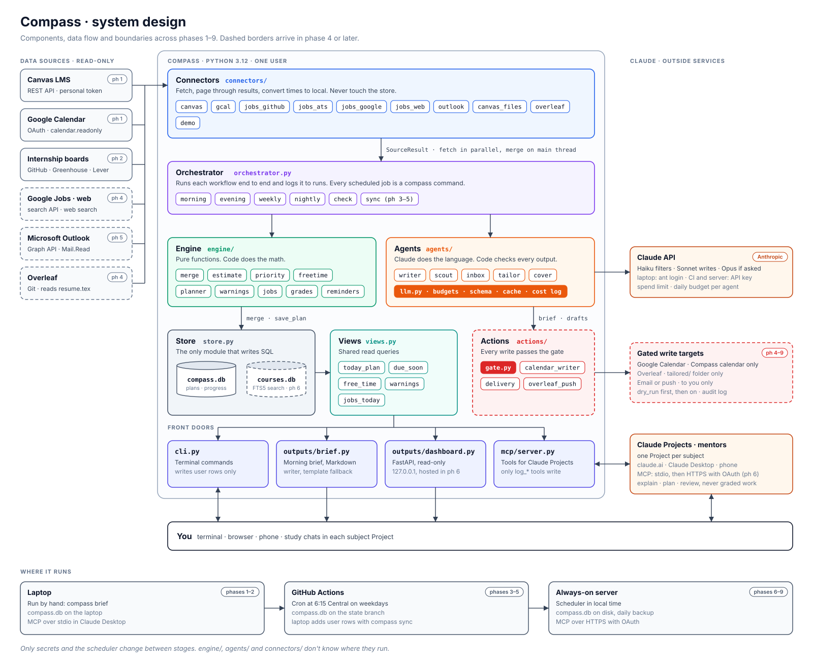
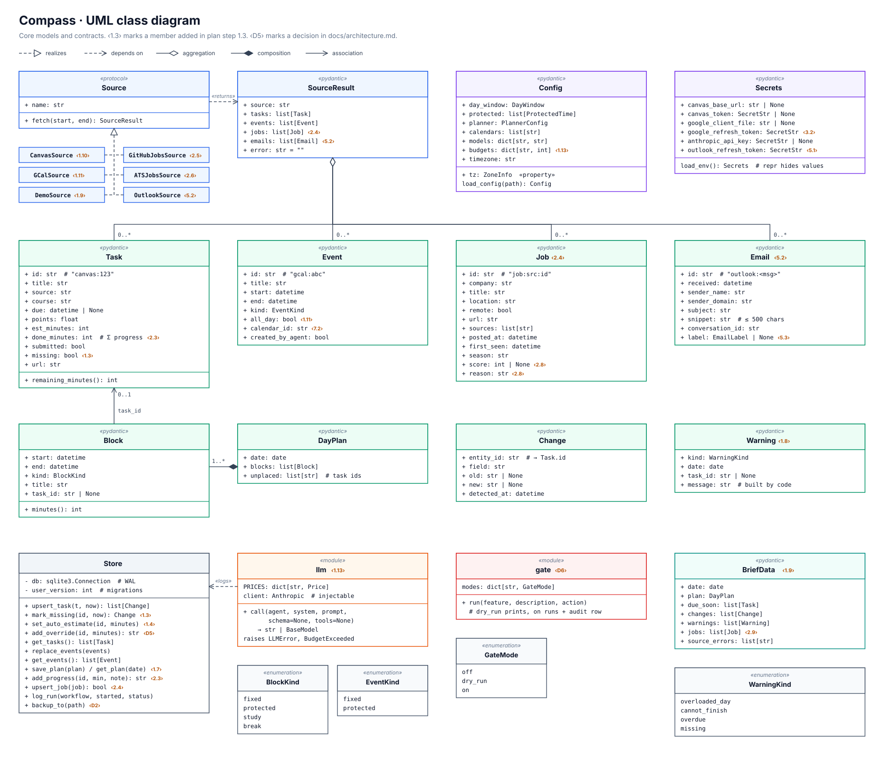
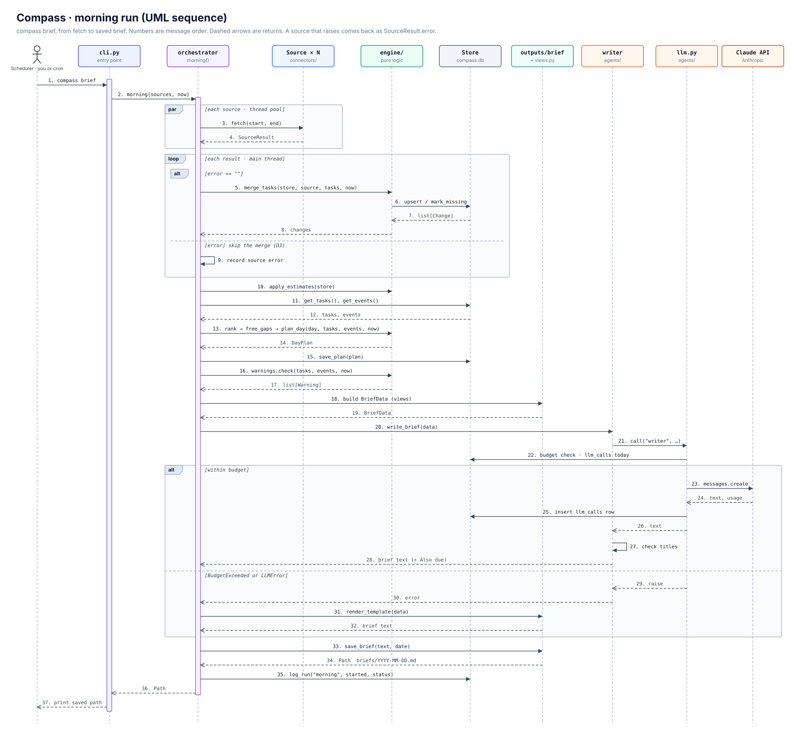

# Compass architecture

This is how the code is laid out, how data moves through it, and which rules hold it together. `plan/` says *what* gets built and *when*. This file says *where it goes* and *what it may depend on*. When a step and this file disagree, fix one of them before building.

## Diagrams

| Diagram | Shows |
|---|---|
| [System design](diagrams/system-design.svg) | Components, data flow, outside services, where it runs |
| [UML class diagram](diagrams/uml-class.svg) | Models, the `Source` contract, `Store`, `llm`, `gate`, enumerations |
| [UML sequence: morning run](diagrams/uml-sequence-morning.svg) | `compass brief` from fetch to saved brief, including the failure paths |

They're plain SVG files. When the architecture changes, edit them directly, or have Claude regenerate the one that changed.

## 1. Shape

Compass is a batch pipeline with a few read-mostly front doors.



The same picture in text, for terminals and Claude Code:

```
                 ┌────────────────────────── connectors/ ───────────────────────────┐
                 │ canvas   gcal   jobs_github  jobs_ats  jobs_google  jobs_web     │
                 │ outlook  canvas_files  overleaf   demo                           │
                 └───────────────┬──────────────────────────────────────────────────┘
                                 │ SourceResult(tasks, events, jobs, emails, error)
                                 ▼                       (fetched in parallel threads)
 ┌─────────────── orchestrator.py: workflows (morning, evening, weekly, nightly) ──────────┐
 │                                                                                         │
 │  merge ─▶ estimate ─▶ rank ─▶ free time ─▶ plan ─▶ warnings ─▶ jobs filter/select       │
 │  └─────────────── engine/: pure functions, code does all the math ──────────────┘       │
 │                                                                                         │
 │  agents/: writer, scout, inbox, tailor, cover ── every call via agents/llm.py           │
 │                                                                                         │
 │  actions/: calendar writer, delivery, overleaf push ── every write via actions/gate.py  │
 └───────────────┬─────────────────────────────────────────────────────────────────────────┘
                 ▼
          store.py ── compass.db (SQLite)          courses.db (FTS5, phase 6)
                 ▲
                 │ views.py: shared read queries (plan for a course, due soon, free time…)
     ┌───────────┼─────────────────┬────────────────────┐
    cli.py   outputs/brief.py   outputs/dashboard.py   mcp/server.py ──▶ Claude Projects
                                                         ▲                  (mentors)
                                   log_progress ─────────┘  the only write path from a chat
```

Compass plans. The Claude Projects mentor. Compass has no chat of its own. Projects reach it only through the MCP tools.

## 2. Packages and what each may import

Dependencies point one way: down this table. A module may import from rows below it, never from rows above.

| Layer | Modules | Does | May import | Never |
|---|---|---|---|---|
| Entry points | `cli.py`, `mcp/server.py`, `outputs/dashboard.py` | Parse input, call workflows or views, format output | anything below | hold business logic |
| Workflows | `orchestrator.py` (later `sync.py`) | Run a pipeline end to end, log it to `runs` | everything below | be imported by engine, agents or connectors |
| Read side | `views.py`, `outputs/brief.py` | Build read models (`BriefData`, a course's plan, due soon) | store, engine, models | write to the store |
| Outside writes | `actions/` | Calendar, delivery, Overleaf push | gate, models, config | run without the gate |
| Language | `agents/` | Prompt, call, verify, fall back | `agents/llm.py`, models, config | touch the store directly (only `llm.py` logs to `llm_calls`) |
| Data in | `connectors/` | Fetch, page through results, convert to local time, map to models | models, config, `requests`, `agents/llm.py` (only `jobs_web` and alert parsing) | touch the store, read env or `config.yaml` |
| Logic | `engine/` | Dates, slots, scores, filters, grades | models, config | do I/O, call `datetime.now()`, call Claude |
| Persistence | `store.py` | SQLite schema, migrations, typed reads and writes | models | contain rules beyond change detection |
| Base | `models.py`, `config.py`, `demo.py` | Pydantic models, settings, fake data | stdlib, pydantic (plus pyyaml and python-dotenv in `config.py` only) | anything in `compass` above them |

The one deliberate exception is `engine/merge.py`, which takes a `Store`, because merging is a store operation. Keep it the only one.

Rules that follow from this:
- **Time is injected.** Every engine and workflow function takes `now`. Only entry points call `datetime.now(config.tz)`. That makes demo mode, tests and replays all work the same way.
- **Settings are injected.** Entry points call `load_config()` and `load_env()` once and pass `Config` and `Secrets` down. Connectors get their token through the constructor.
- **Every scheduled thing is a CLI command.** GitHub Actions, the server's cron and APScheduler only ever run `compass <command>`. That keeps each hosting move (laptop → Actions → server) a config change, not a code change.

## 3. Core contracts

These interfaces are what the steps build against. Change them on purpose.



**Models** (`models.py`): `Task`, `Event`, `Block`, `DayPlan`, `Change`, then `Job` (2.4), `Email` (5.2) and `Warning` (1.8, in `engine/warnings.py`). IDs are source-prefixed: `canvas:123`, `gcal:abc`, `job:greenhouse:456`, `outlook:<msg>`, `demo:…`.

**Sources** (`connectors/base.py`):
```python
class SourceResult(BaseModel):
    source: str
    tasks: list[Task] = []
    events: list[Event] = []
    jobs: list[Job] = []          # from 2.4
    emails: list[Email] = []      # from 5.2
    error: str = ""               # non-empty means "don't trust the lists"

class Source(Protocol):
    name: str
    def fetch(self, start: datetime, end: datetime) -> SourceResult: ...
```
One result type for every source keeps the orchestrator's loop the same: fetch in parallel, collect errors, merge on the main thread.

**Store** (`store.py`): one class, one connection, typed methods per table. It is the only place that writes SQL.

**LLM** (`agents/llm.py`): `call(agent, system, prompt, schema=None, cache_system=True, tools=None)`. It looks up the model by agent name, enforces the daily budget, validates against the schema (one retry), and logs tokens and cost.

**Gate** (`actions/gate.py`): `run(feature, description, action)` with modes `off`, `dry_run` and `on` per feature. Every action that changes something outside Compass goes through it.

## 4. Workflows

### Morning (1.9 → 2.9 → 3.4)



1. **Fetch.** All configured sources run in a thread pool. Each source's exceptions are caught and turned into `SourceResult.error`. Threads only fetch. They never touch the store, because a sqlite3 connection must stay on its thread.
2. **Merge** (main thread). Changes are recorded in `changes`. A source with an error is **not merged at all** (see decision D3).
3. **Estimate.** Automatic estimates for tasks without an override.
4. **Plan.** `rank` → `free_gaps` → `plan_day` → `save_plan`.
5. **Warnings** for the next 14 days.
6. **Jobs** (phase 2+): upsert, `dedupe` → `filter_jobs` → scout (only unscored jobs) → `select_daily`.
7. **Write.** `BriefData` is built by `views.py`. The writer agent writes the brief, and code checks it. Any failure falls back to `render_template`.
8. **Save** `briefs/YYYY-MM-DD.md`, log one `runs` row, then (later phases) `compass check` and `compass deliver`.

### Others
| Workflow | When | From step | Does |
|---|---|---|---|
| evening | 21:30 | 7.4 | Unlogged blocks → a message. Estimate correction factors |
| weekly | Sunday evening | 7.5 | Week preview, spend by agent |
| nightly | night | 6.5 | Canvas files → text extraction → `courses.db` index |
| check | after morning | 3.6 | Fetch Canvas again and fail the run if the brief missed anything |

Each one is a function in `orchestrator.py` wrapped the same way: start time, try/except, a `runs` row.

## 5. Data

### `compass.db` tables
| Table | Added | Owner | Kind |
|---|---|---|---|
| `tasks`, `events`, `changes`, `plans`, `runs`, `llm_calls` | 0 | pipeline | derived from sources |
| `progress` | 2.3 | **user** | append-only, UUID |
| `jobs`, `job_boards` | 2.4, 2.6 | pipeline | derived |
| `estimate_overrides` | D5 | **user** | append-only, UUID, latest wins |
| `job_sources`, `api_usage` | 4.1, 4.2 | pipeline | derived |
| `application_events` | 4.8 (D5) | **user** | append-only, UUID. The current status is the latest row |
| `emails` | 5.2 | pipeline | derived, snippets only |
| `audit` | 7.1 | gate | append-only |
| `exams` | 8.1 | pipeline | derived |
| `habit_log` | 9.3 | **user** | append-only, UUID |

`courses.db` (phase 6) is separate and rebuildable: FTS5 chunks per course, never in git and never backed up with personal data elsewhere.

Rules:
- **Times are stored as UTC ISO strings** and read back as aware datetimes (D2). The engine converts to `config.tz` when it needs wall-clock time (day windows, "tonight"). Outputs format in local time.
- **Migrations** use `PRAGMA user_version` and an ordered list of SQL steps in `store.py`. Step 1.3's `missing` column is migration 1. No ad hoc `ALTER TABLE` checks elsewhere.
- **WAL mode and `busy_timeout`**: the MCP server keeps a connection open while `compass brief` writes.
- **Copy the database with the sqlite backup API** (`Store.backup_to(path)`), never by copying the file. This applies to `compass sync`, the Actions upload and server backups. With WAL on, a plain file copy can miss recent writes.

### Who owns what
Source data is refreshed from the source every run. User data comes from you, through the CLI or a Project. User data is always append-only rows with UUIDs. That one rule is what makes the phase 3 sync safe: `compass sync` copies every user-owned table's missing rows into the Actions database, and both sides converge. Nothing you type on the laptop gets overwritten by the next scheduled run.

## 6. Agents

Every agent has the same four parts:

```
prepare (code)  →  llm.call (one module)  →  verify (code)  →  fallback (code)
 compact JSON,      model by agent name,      schema, plus a     template, skip,
 no URLs or         budget, cache, log        domain check       or keep original
 secrets
```

| Agent | Tier | Step | Code checks the output by | On failure |
|---|---|---|---|---|
| `writer` | Sonnet | 1.14 | Every due task and selected job appears by title, and missing ones are appended | Template brief |
| `scout_filter` | Haiku | 2.8 | Schema. The result is saved on the job, so it's never re-sent | Job stays unscored |
| `scout` | Sonnet | 2.8 | Schema. `select_daily` picks in code and never pads | Fewer jobs, with a note |
| `jobs_web` | Sonnet + web search | 4.3 | Drops listings with no date or a bad URL | Source skipped |
| `tailor` | Sonnet | 4.5 | Truthfulness diff (numbers, employers, technologies), preamble byte-identical | Bullet reverted |
| `cover` | Sonnet (Opus with `--best`) | 4.7 | Claims must come from the profile or resume | Flagged |
| `inbox` | Haiku | 5.3 | Labels from a fixed set. Dates parsed by code. Cached by message ID | `fyi` |
| deadline match, replies, exam lines | Haiku | 5.4, 5.6, 8.1 | Only used on ties. Status changes need you to confirm | No change |

Model IDs and daily budgets live in `config.yaml` under `models:` and `budgets:`, keyed by agent name.

## 7. Front doors

`views.py` is the shared read layer (D4). The brief, the dashboard and the MCP tools all ask it the same questions: today's plan (optionally for one course), due within N days, warnings, free time on a day, today's jobs. That way "what's due" can't mean three different things in three places.

| Front door | Transport | Writes | From step |
|---|---|---|---|
| CLI | terminal | estimates, progress, applications (all as user rows) | 1.9 |
| Brief | Markdown file, later email or push | nothing | 1.9, 5.7 |
| Dashboard | FastAPI on `127.0.0.1`, later hosted behind login | nothing | 2.10, 6.9 |
| MCP server | stdio (Claude Desktop), later HTTPS with OAuth | `log_*` tools only, to append-only user tables | 2.1, 6.3 |

`compass mcp --demo` and `compass dashboard --demo` run the morning workflow into an in-memory database at `DEMO_TODAY` on startup, so they have a plan to serve.

In phase 6 the dashboard and the HTTP MCP endpoint can be one ASGI app behind one login.

## 8. Where it runs

| Stage | Phases | Morning run | Who owns `compass.db` | MCP | Dashboard |
|---|---|---|---|---|---|
| Prototype | 1–2 | laptop, by hand | laptop | stdio in Claude Desktop | localhost |
| Scheduled | 3–5 | GitHub Actions cron | Actions, stored on the `state` branch. The laptop adds user rows with `compass sync` | stdio, pull-sync at startup | localhost |
| Server | 6–9 | server scheduler, local time | server disk, daily backup | HTTPS + OAuth, stdio kept | hosted, behind login |

Nothing in `engine/`, `agents/` or `connectors/` knows which stage it's in. Only `Secrets` sources (`.env`, Actions secrets, host secrets) and the scheduler change.

## 9. Safety boundaries

- **Secrets** enter through `load_env()` only, go to connectors through constructors, and never appear in a prompt, log, `repr`, tool result or error message. Overleaf and Git tokens are redacted from exceptions.
- **Read-only scopes first.** Write scopes (`calendar.app.created` or `calendar.events`, `Mail.Send`) are added only in the phase that needs them.
- **Writes outside Compass** all pass through `actions/gate.py` and are recorded in `audit`. Guards inside each action are code, not prompts: only `compass=1` events on the Compass calendar, only `tailored/` in Overleaf, mail only to the signed-in user.
- **The model sees the minimum**: titles, courses, times, minutes, email snippets. No URLs with tokens, no full threads, no whole courses.
- **Mentors never write graded work.** This is enforced by the Project instructions, which Compass generates.

## 10. Tests

| Layer | How it's tested |
|---|---|
| engine | Unit tests on hand-made data plus `demo.py`. Property-style randomized tests for the planner |
| store | `:memory:` databases. Migration from an old schema |
| connectors | Scrubbed fixtures in `tests/fixtures/<source>/` behind a mocked HTTP layer. No network, ever |
| agents | A fake client injected into `llm.py`. Labeled sample sets rerun by hand when a prompt or model changes |
| MCP and dashboard | Every tool and section against demo data |
| end to end | `compass brief --demo --no-llm` in CI |

## 11. Decisions this file adds

These aren't in `plan/README.md` yet. Each one says which step it lands in.

- **D1. `pyproject.toml` finds packages automatically** (`[tool.setuptools.packages.find] include = ["compass*"]`). The hard-coded list would leave out `compass/mcp` and `compass/actions`. *Lands in 1.9* (the first `pip install -e` the plan relies on) *or 2.1 at the latest.*
- **D2. UTC in SQLite, aware datetimes everywhere.** Local ISO strings change offset at daylight saving time (−06:00 to −05:00 in March), so string comparisons in SQL and change detection would break across the switch. *Lands in 1.3* (it already changes the store and its tests).
- **D3. A failed source is never merged.** Otherwise one Canvas outage marks every task missing. Also, a task is marked missing only if its stored due date falls inside the window that was fetched. *Lands in 1.3 and 1.9.*
- **D4. `views.py` is the shared read layer** for the brief, the MCP tools and the dashboard. *Lands in 2.2, and 2.10 reuses it.*
- **D5. User data is append-only rows with UUIDs**: `progress`, `estimate_overrides`, `application_events`, `habit_log`. `compass sync` carries all of them, not just `progress`. *Lands in 1.4 (overrides), 3.3 (sync), and 4.8 (applications).*
- **D6. The write gate comes earlier**, at the first outside write (4.6, the Overleaf push), not 7.1. That way 4.6 and 5.7 don't build their own `write`/`enabled` flags only to replace them later.
- **D7. The MCP write rule** becomes "only `log_*` tools write, and only to append-only user tables". 9.3 adds `log_habit`, which contradicts "`log_progress` is the only tool that writes".
